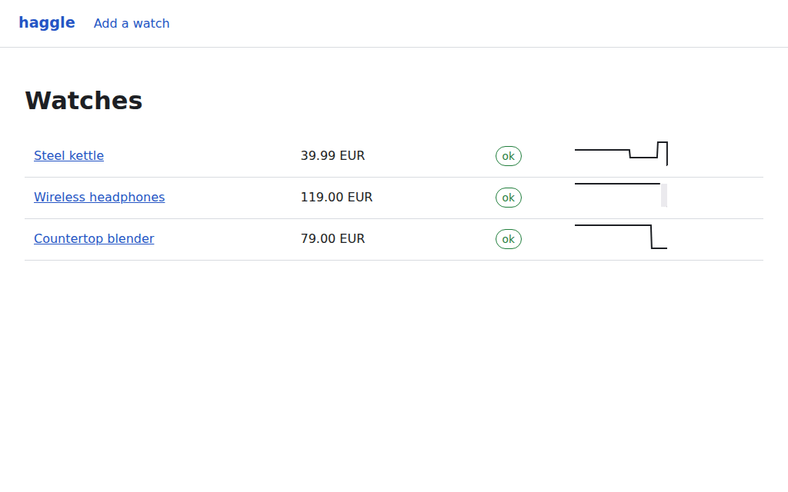
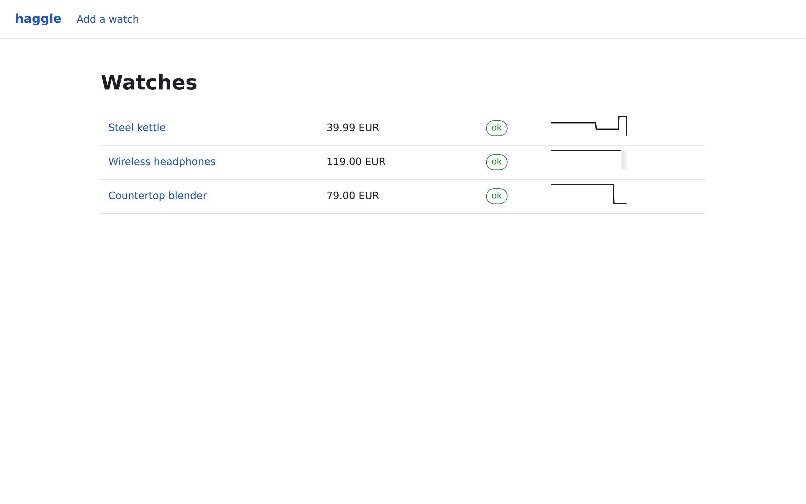
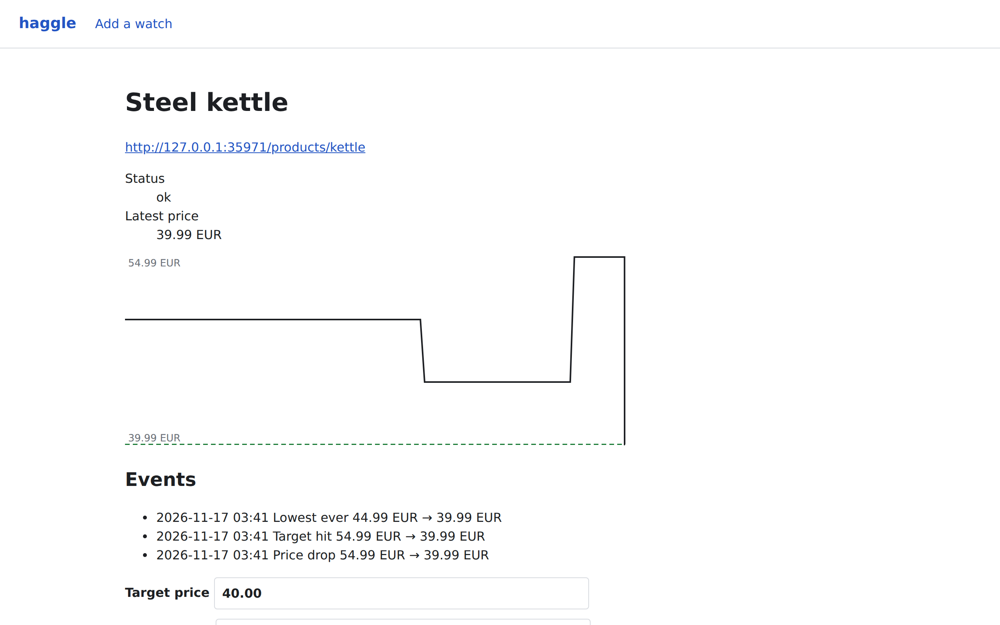

# Haggle

Know when a product's price drops or the item is back in stock.


## Overview

Haggle is a self-hosted price and stock watcher: give it a product URL, and it tells you when the price drops or the item is back in stock. It is for personal use on a home server, for buying homelab, hobby and work items at their lowest price. It judges a discount against the prices it has observed itself, and it flags a "sale" whose claimed "was" price its own history never reached. It reads the price from the product page's HTML and does not run JavaScript or log in, so shops that render prices in the browser or block non-browser clients will not work.



## Features

- `haggle check URL` reads a product's price from its page, with the currency, list price, availability and title when the page gives them.
- Prices are tried in order: schema.org JSON-LD, Open Graph and `product:price:*` meta tags, schema.org microdata, then a CSS selector you supply with `--selector`. The first valid price wins, and the output names its source.
- Money is stored as integer minor units with an ISO 4217 currency code, never as floating point.
- Fetches are bounded and identify the client: a 20-second timeout, a 5 MiB size limit, and a User-Agent that names the project and its repository. Polite defaults lower the load on a shop but do not change its terms, and some shops forbid automated access, so read a shop's terms before you watch it.
- Watches are stored in SQLite. You add a product with an optional target price and check interval, list the watches, read their price history and remove them.
- `haggle serve` checks due watches every 30 seconds, honours robots.txt and backs off after HTTP 429 responses.
- A watch that cannot be read is marked `needs-selector` when no price is found, `blocked` when robots.txt or the shop refuses the check, or `error` for any other failure. `haggle ls` shows the state.
- Email alerts through Gmail: one email per watch per check, with the subject taken from the events, one body line per event, and the product link. Price drops and rises, a target reached, the lowest price seen, out of stock and back in stock, and an inflated sale (a "sale" that is not one) are each emailed once. A failed send is retried on the next scheduler tick.
- A web dashboard, served by `haggle serve` on `HAGGLE_LISTEN`. The dashboard lists every watch with its latest price, change, status and a sparkline. A watch page has the full price chart with its target line and stock gaps, the event list, and forms to edit the target and interval, pause or resume the watch, and delete it. The add form has a Preview button that shows what would be extracted before you save. The pages are plain HTML forms with no JavaScript, and the charts are SVG drawn on the server.
- A demo with a built-in fake shop: `make demo` or `haggle demo` runs the shop, a temporary database and the dashboard with time 60 times faster, so the whole loop is visible within a minute.
- A systemd service unit and a daily database backup that keeps the newest seven copies, in [deploy/](deploy/).

## Quick start

Prerequisites:

- Rust stable with edition 2024 support (Rust 1.85 or newer), installed with [rustup](https://rustup.rs). Ubuntu's apt `rustc` is too old for edition 2024.
- A C compiler and git. On Ubuntu, install `build-essential` and `git` from apt.
- Linux on x86-64. The project targets `x86_64-unknown-linux-gnu`.

Clone the repository and build the release binary:

```sh
git clone https://github.com/NC4321/haggle.git
cd haggle
make build
```

The first build compiles the dependencies and can take several minutes. It writes `target/release/haggle`.

Run the demo:

```sh
make demo
```

It prints the path of its temporary database and the dashboard URL:

```text
database: /tmp/haggle-demo-12345.db
dashboard: http://127.0.0.1:8421/
```

The temporary directory and the process ID vary. Open the dashboard URL in a browser. Within a minute, the steel kettle's price falls to 39.99 EUR and the wireless headphones come back in stock. Press Ctrl-C to stop the demo; it deletes its temporary database when it exits.

## Usage

Commands other than `check` and `demo` store their data in the database named by `HAGGLE_DB`, described under [Configuration](#configuration). The examples below set it inline.

Check a product page once. It prints what it found and stores nothing:

```sh
./target/release/haggle check https://shop.example/item
```

```text
price: 1299.00 EUR
availability: in stock
title: Example Phone
source: json-ld
```

Watch a product with a target price. `--target` needs the currency, and `--every` takes a number and one of `s`, `m`, `h` or `d`; it defaults to `6h` and must be at least `5m`:

```sh
HAGGLE_DB=./haggle.db ./target/release/haggle add https://shop.example/item --name "Example Phone" --target "199.99 EUR" --every 6h
```

```text
added watch 1
```

Show a watch's recorded prices, oldest first. `ls` lists every watch with its status and latest price, and `rm ID` stops a watch and deletes its history:

```sh
HAGGLE_DB=./haggle.db ./target/release/haggle history 1
```

```text
2026-11-16 18:00 UTC  1299.00 EUR  in stock
```

Run the scheduler and the dashboard until Ctrl-C or SIGTERM, then open `http://127.0.0.1:8421/` on the same machine. Each check sends at most one email per watch, and only when it found events. Set the three Gmail variables together, or none of them: without them, `serve` still checks watches and logs a warning that notifications are off.

```sh
export GMAIL_USER=alerts@example.com
export GMAIL_APP_PASSWORD=your-app-password
export ALERT_EMAIL=you@example.com
HAGGLE_DB=./haggle.db ./target/release/haggle serve
```

The dashboard lists every watch on one page, and each watch has its own page with the price history:





## Configuration

Environment variables are read once at startup. `check` needs none of them.

| Setting | Default | What it does |
| --- | --- | --- |
| `--log-level LEVEL` (flag, all commands) | `warn` | Log filter written to stderr, for example `debug` or `haggle=trace`. |
| `HAGGLE_DB` (required by `add`, `ls`, `history`, `rm` and `serve`) | none | Path of the SQLite database file, created if it does not exist and migrated when it opens. Unset, the command exits with status 2. The hp-server deployment uses `/mnt/database/haggle/haggle.db`, see [Deployment](#deployment). |
| `HAGGLE_LISTEN` (`serve` and `demo`) | `127.0.0.1:8421` | Address the web UI listens on. A malformed value exits with status 2. The web UI has no login, so listen only on an address you trust. |
| `GMAIL_USER` (optional, with the two below) | none | The Gmail address that sends the alerts. |
| `GMAIL_APP_PASSWORD` (optional, with the two below) | none | The Gmail app password of `GMAIL_USER`. It is a secret, and it never appears in logs or error messages. |
| `ALERT_EMAIL` (optional, with the two above) | none | The address that receives the alerts. |
| Demo database | system temporary directory | `haggle-demo-<pid>.db`, created by `demo` and deleted when it exits. `demo` ignores `HAGGLE_DB`. |

The three email variables are all set or all unset. With none of them set, `serve` runs with notifications off and logs a warning. With some of them but not all, the configuration is invalid and the command exits with status 2. Haggle sends through `smtp.gmail.com` on port 587 with STARTTLS, logging in as `GMAIL_USER`.

Configuration errors, such as an unset `HAGGLE_DB`, a malformed `HAGGLE_LISTEN` or a partial set of email variables, exit with status 2. Other errors exit with status 1.

## Deployment

Haggle runs on hp-server as a systemd service. `haggle serve` runs as the `haggle` user and reads `HAGGLE_DB` and `HAGGLE_LISTEN` from `/etc/haggle/haggle.env`. It reads the three email variables from `/opt/speedtest/.env`, the file shared with isp-speed-monitor, so the app password lives only there. A timer takes a daily backup with `VACUUM INTO` and keeps the newest seven copies. The unit files are in [deploy/](deploy/), and [deploy/README.md](deploy/README.md) covers installing, updating and restoring step by step.

To update an install, pull the new code, check it and install it, then restart the service:

```sh
git pull && make check && make install
sudo systemctl restart haggle
```

Restoring a backup replaces the database, so stop the service first; the guide has the steps. The hp-server checks that need the real server, which are running for 48 hours, storing five real items, restoring a backup once, and a real price drop arriving in the inbox, are still to be done.

## Project structure

```text
haggle/
├── Cargo.toml                  # package, binary and dependencies
├── Makefile                    # build, test, check, demo and install targets
├── rustfmt.toml                # formatter settings
├── migrations/
│   └── 001_init.sql            # the first schema, applied when the database opens
├── src/
│   ├── main.rs                 # the haggle binary: arguments, logging, exit status
│   ├── lib.rs                  # the library crate and its modules
│   ├── cli.rs                  # the check, add, ls, history, rm, serve and demo commands
│   ├── config.rs               # environment variables into one validated Config
│   ├── fetch.rs                # page fetching: timeout, size limit, robots.txt, 429 pauses
│   ├── extract/                # the ordered price chain: JSON-LD, meta, microdata, selector
│   ├── db/                     # SQLite: opening, watches, observations and events queries
│   ├── rules.rs                # event rules over a watch's price history
│   ├── scheduler.rs            # the check loop: due watches, storage and notifications
│   ├── notify.rs               # email client, sends the alerts through Gmail
│   ├── money.rs                # Money: integer minor units with a currency code
│   ├── web/                    # the web UI: router, dashboard, watch and add pages, SVG chart
│   └── demo_shop.rs            # the fake shop behind haggle demo
├── templates/                  # HTML templates of the web UI
├── static/
│   └── style.css               # the web UI stylesheet
├── tests/                      # integration tests, one file per module
│   └── fixtures/               # saved product pages with hand-written expected prices
├── deploy/                     # systemd units for the service and the daily backup
│   ├── haggle.service          # the service: haggle serve with its two environment files
│   ├── haggle-backup.service   # the backup job: VACUUM INTO, newest seven kept
│   ├── haggle-backup.timer     # starts the backup once a day
│   └── README.md               # install, update and restore on hp-server
├── docs/
│   ├── design/                 # design notes on extraction and scheduling
│   └── plan/PLAN.md            # decisions, architecture and milestones
└── media/                      # screenshots and the demo GIF
```

The design notes are [how prices are extracted](docs/design/extraction.md) and [how checks are scheduled](docs/design/scheduling.md). The plan, with its decisions and milestones, is in [docs/plan/PLAN.md](docs/plan/PLAN.md).

## Development

Run these from the project root:

```sh
make build                                   # release build (cargo build --release)
make test                                    # all tests (cargo test)
cargo test <name>                            # one test, by name
make check                                   # format check, lint, release build and tests
make demo                                    # run the demo (cargo run --release -- demo)
make install                                 # copy the binary to /usr/local/bin and the units to /etc/systemd/system (uses sudo)
cargo fmt --all --check                      # format check only
cargo clippy --all-targets -- -D warnings    # lint only
```

Integration tests live in `tests/`, one file per module. Command tests are named `cli_*`, web tests `web_*`, and database tests `db_*`. Extraction is tested against saved pages in `tests/fixtures/`, grouped by extractor (`jsonld`, `meta`, `microdata`, `selector`), with `chain` for the ordered chain and `cli` for `haggle check`. Each page's expected price is written by hand, never copied from the extractor's output. Fetch tests run against a local test server. No test touches the internet or the live database.

## Roadmap

- [x] **M1 · Read a price from a page.** `haggle check URL` prints the price, currency, availability and where it found them.
- [x] **M2 · Watch, remember, notify.** Watches are checked on a schedule, and a price drop sends one notification.
- [x] **M3 · Dashboard and demo.** The web UI shows every watch with its chart, and anyone can see it work in a minute.
- [x] **M4 · Running on hp-server.** Haggle watches real items from the homelab.
- [ ] **M5 · Email notifications.** Price and stock events arrive by email through Gmail.

The decisions, architecture and task list of each milestone are in [docs/plan/PLAN.md](docs/plan/PLAN.md).

## Contributing

This repository is built milestone by milestone with agent-board. Each milestone has one branch, `board/m<k>-<name>` (for example `board/m5-email-notifications`), with one commit per card, and one pull request into `main` once its checks are green. Humans review and merge. Merges are squash merges, and merged branches are deleted.

Before you open a pull request, run the checks yourself. There is no CI yet, so `make check` is the gate. It runs the format check, the linter, the release build and the tests:

```sh
make check
```

## License

No license yet.
